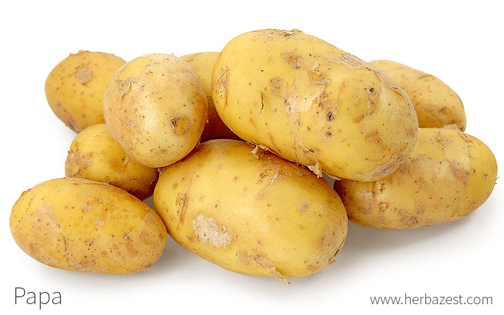
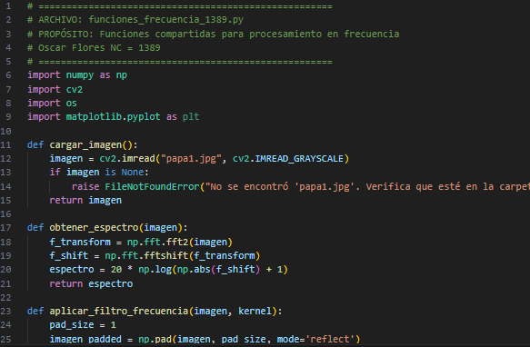
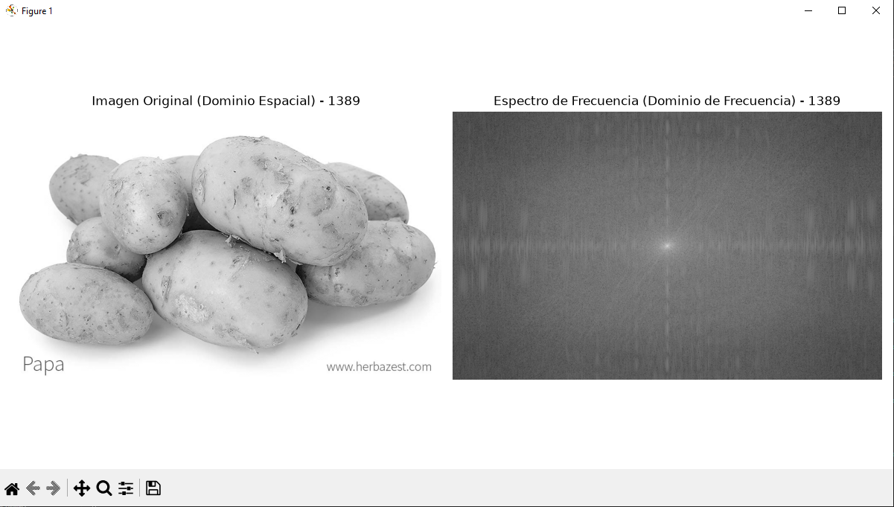
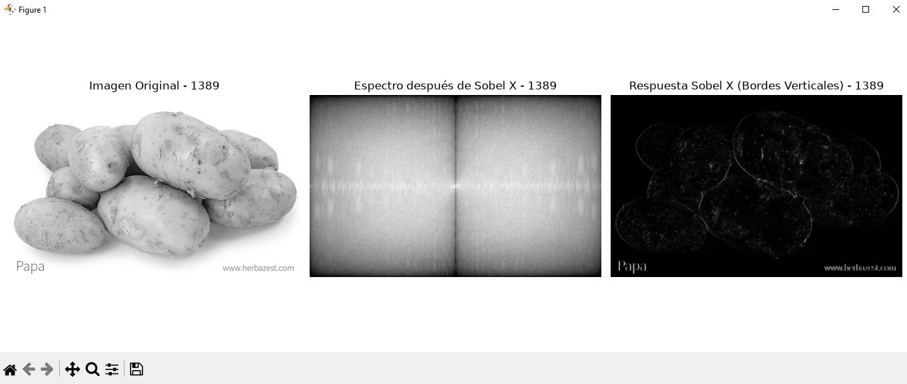
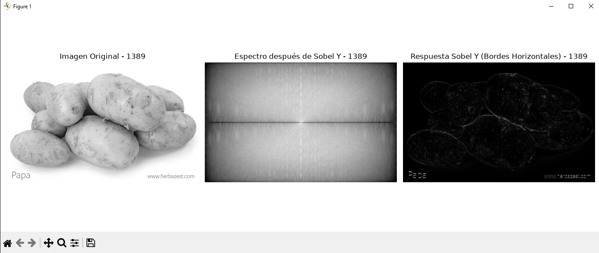
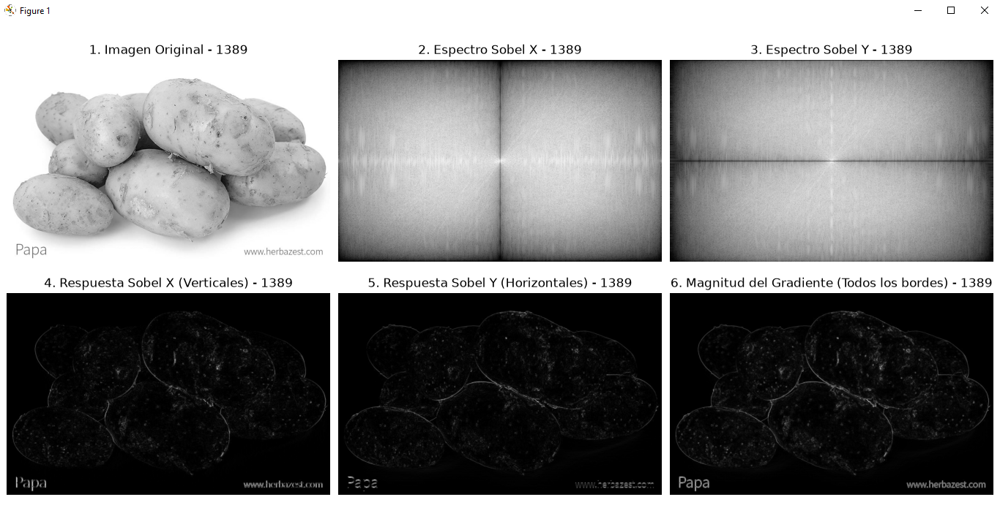

## 🎯 Propósito de la actividad

Conocer y utilizar 60 imágenes diferentes para realizar prácticas de procesamiento digital de imágenes mediante Python.

Las imágenes permitirán experimentar con operaciones como:

- 🔍 Detección de bordes y contornos.
- 🎨 Análisis de colores y canales RGB.
- 🌫️ Aplicación de filtros y reducción de ruido.
- 📊 Análisis de histogramas y contraste.
- 🔄 Rotación, recorte y redimensionamiento.
- 🧩 Segmentación y reconocimiento de regiones.
- 📐 Detección de características y patrones.

# Oscar Flores NC = 1389
# Imagen Original

# Preparar las funciones comunes

# Ejemplo 1: Cargar la imagen y visualizar su espectro

# Ejemplo 2: Aplicar el filtro Sobel X en el dominio de la frecuencia

# Ejemplo 3: Aplicar el filtro Sobel Y en el dominio de la frecuencia

# Ejemplo 4: Calcular la magnitud del gradiente y comparar
